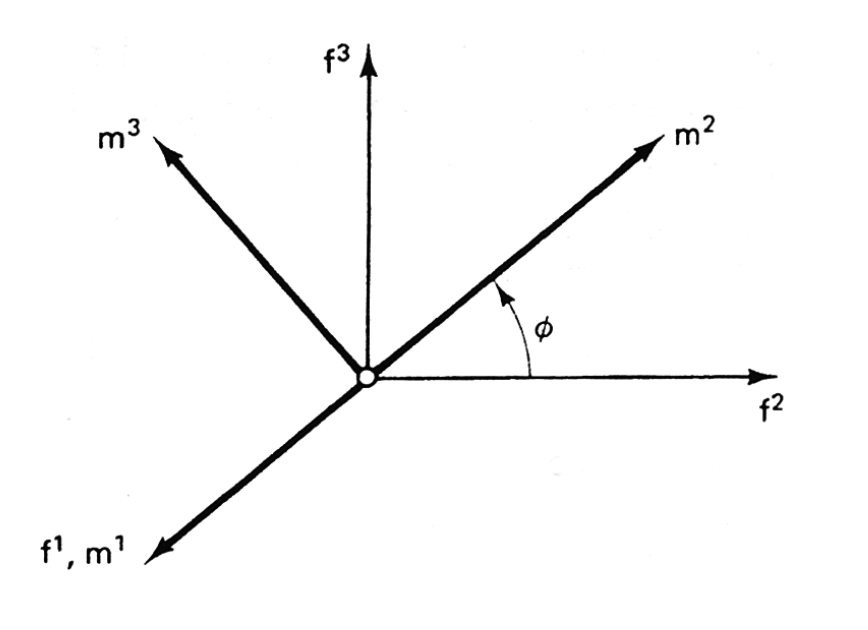
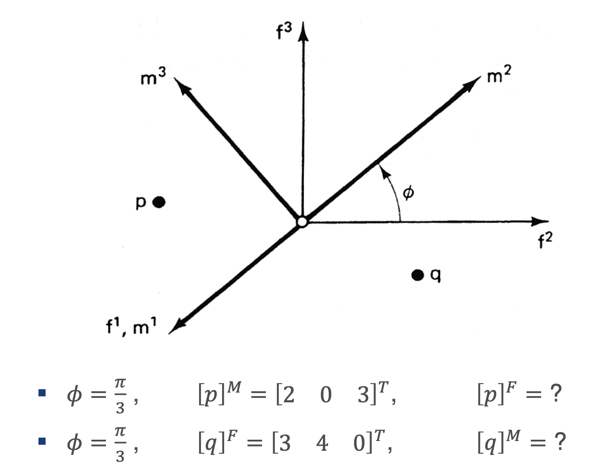
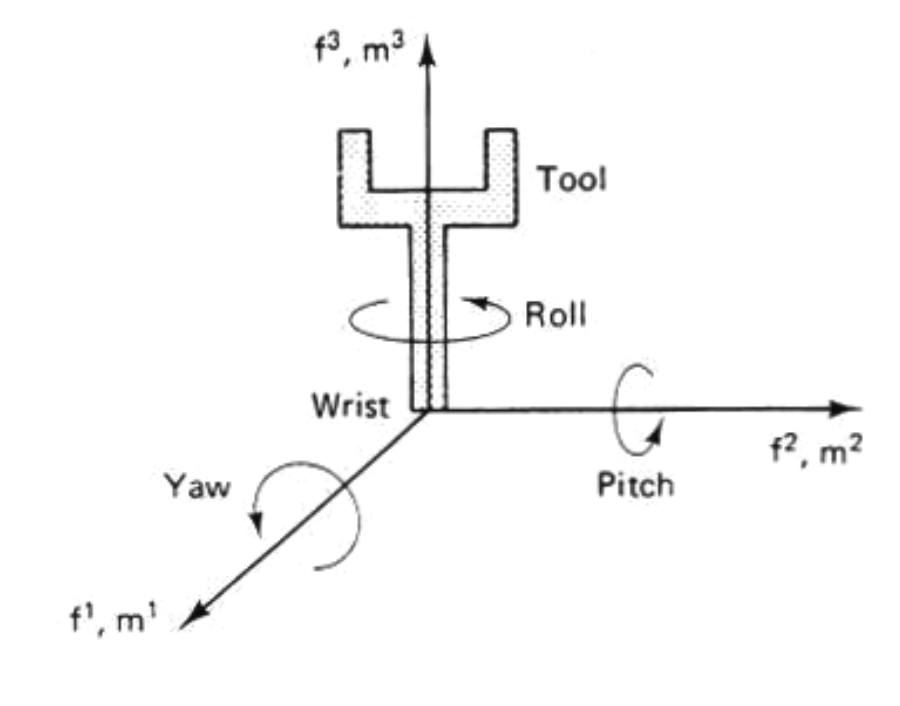
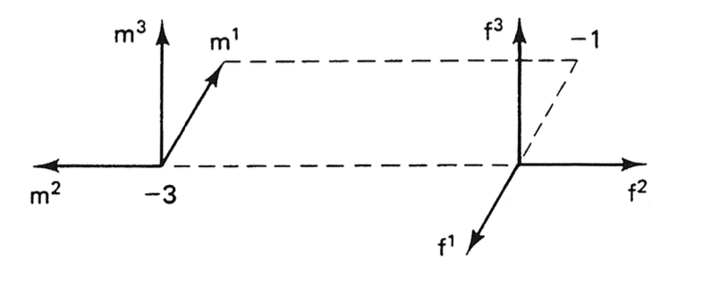
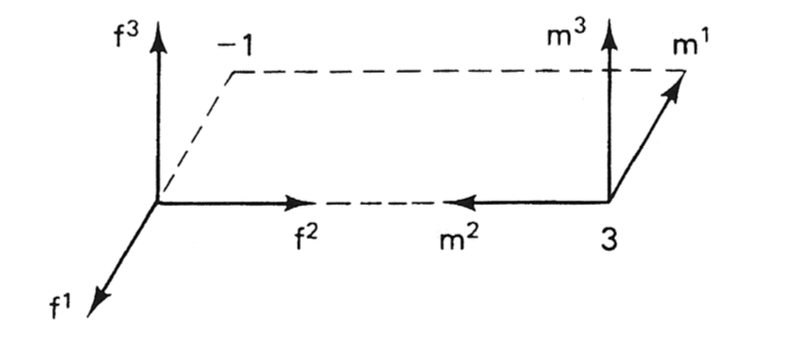
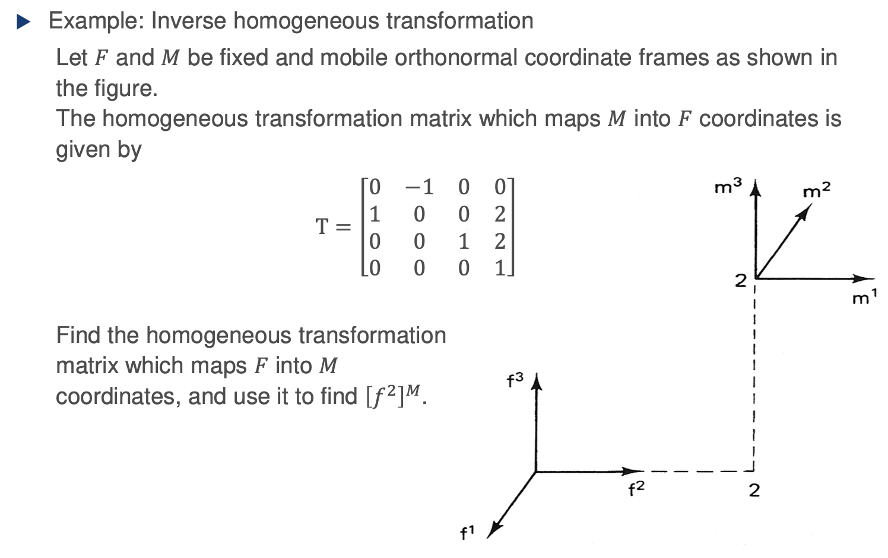

#  Mathematical Background
## Projection
### Dot product
Dot Product:
Angle $\theta$ between two vectors $x$ and $y$ in $\mathbb{R}^3$:

$$
\begin{aligned}
x \cdot y = x^T y = \Vert x \Vert \Vert y \Vert \cos\theta
\end{aligned}
$$

### Cross Product
Cross product between two vectors $u$ and $v$ in $\mathbb{R}^3$ is a vector $w = u \times v$, which is orthogonal to $u$ and $v$:
  $$
  \begin{aligned}
  w &= \det{\begin{bmatrix} i^1 & i^2 & i^3 \\ u_1 & u_2 & u_3 \\ v_1 & v_2 & v_3 \end{bmatrix}} \\
  &= +i^{1} \cdot \det{\begin{bmatrix} u_2 & u_3 \\ v_2 & v_3 \end{bmatrix}} - i^{2} \cdot \det{\begin{bmatrix} u_1 & u_3 \\ v_1 & v_3 \end{bmatrix}} + i^{3} \cdot \det{\begin{bmatrix} u_1 & u_2 \\ v_1 & v_2 \end{bmatrix}} \\
  &= w = (u_2v_3-u_3v_2)i^1+(u_3v_1-u_1v_3)i^2+(u_1v_2-u_2v_1)i^3\\
  &= w = (u_2v_3-u_3v_2)\begin{bmatrix}1\\0\\0\end{bmatrix}+(u_3v_1-u_1v_3)\begin{bmatrix}0\\1\\0\end{bmatrix}+(u_1v_2-u_2v_1)\begin{bmatrix}0\\0\\1\end{bmatrix}\\
  &= \begin{bmatrix} u_2v_3 - u_3v_2 \\ u_3v_1 - u_1v_3 \\ u_1v_2 - u_2v_1 \end{bmatrix}
  \end{aligned}
  $$
  with $i^k$ being the $k$-th unit vector

Furthermore: $\Vert u \times v\Vert = \Vert u \Vert \times \Vert v \Vert \sin \theta$

### Coordinates

Let $X = \begin{pmatrix}x^1, x^2, \ldots x^n \end{pmatrix}$ be a complete orthonormal coordinate frame for $\mathbb{R}^n$, any ponit/vector $p\in$ $\mathbb{R}^n$ can be uniquely expressed as a linear combination of the basis vectors:
$$
\begin{aligned}
p = \sum_{k=1}^{n}{[p]^X_k x^k}
\end{aligned}
$$
### Orthonormal Coordinates Propostion
the $k$-th coordinate of $p$ with respect to frame $X$ is obtained by othogonal projection(dot product) onto $x^k$:
$$
\begin{aligned}
[p]_k^X = p \cdot x^k, \quad 1 \le k \le n
\end{aligned}
$$
In $\mathbb{R}^3$, for a fixed base frame $F = \begin{Bmatrix} f^1, f^2, f^3\end{Bmatrix}$ and a mobile link frame $M = \begin{Bmatrix} m^1, m^2, m^3\end{Bmatrix}$ sharing the same origin:
$$
\begin{aligned}
[p]^F = \begin{bmatrix} p \cdot f^1\\ p \cdot f^2\\ p \cdot f^3 \end{bmatrix}, [p]^M = \begin{bmatrix} p \cdot m^1\\ p \cdot m^2\\ p \cdot m^3 \end{bmatrix}
\end{aligned}
$$

### Coordinate Transformation Matrix & Its Inverse
Let $F$ = $\begin{Bmatrix} f^1, \ldots, f^n \end{Bmatrix}$ and $M$ = $\begin{Bmatrix} m^1, \ldots m^n\end{Bmatrix}$ be two orthonoramal frames with the same origin. Define the $n \times n$ matrix $A$ with entries :
$$
\begin{aligned}
A_{kj} = f^k \cdot m^j, A_{kj} = f^k \cdot m^j, \quad 1 \le k, j \le n\
\end{aligned}
$$
Then $A$ maps coordinates from frame $M$ into frames $F$:
$$
\begin{aligned}
[p]^F = A[p]^M
\end{aligned}
$$
Notice that the $j$-th column of A is simply $[m^j]^F = [f^1 \cdot m^j, f^2 \cdot m^j, f^3 \cdot m^j]$, i.e., the unit axis $m^j$ expressed in frame $F$\. 
Inverse Coordinate Transformation: Since A is an orthogonal matrix ($A^TA = I$), mapping coordinates from F back into M is given by the transpose:
$$
\begin{aligned}
[p]^M = A^{-1}[p]^F = A^T[p]^F
\end{aligned}
$$

#### Example 2
Suppose mobile frame $M$ is rotated by $90^\circ$ counter-clockwise around $f^3$ relative to fixed frame $F$. Then in frame $F$:

$$
\begin{aligned}
&m^1 \space points \space along +f^2 \implies [m^1]^F = \begin{bmatrix} 0 & 1 & 0 \end{bmatrix}^T\\

&m^2 \space points \space along -f^1 \implies [m^2]^F = \begin{bmatrix} -1 & 0 & 0 \end{bmatrix}^T\\

&m^3 \space coincides \space with +f^3 \implies [m^3]^F = \begin{bmatrix} 0 & 0 & 1 \end{bmatrix}^T
\end{aligned}
$$
Assembling these three columns gives the transformation matrix $A$:
$$
A = \begin{bmatrix} 0 & -1 & 0 \\ 1 & 0 & 0 \\ 0 & 0 & 1 \end{bmatrix}
$$
If a point has coordinates $[p]^M = \begin{bmatrix} 0.5 \\ 0.6 \\ 1.4 \end{bmatrix}$ in frame $M$, its coordinates in frame $F$ are:
$$
[p]^F = A[p]^M = \begin{bmatrix} 0 & -1 & 0 \\ 1 & 0 & 0 \\ 0 & 0 & 1 \end{bmatrix}\begin{bmatrix} 0.5 \\ 0.6 \\ 1.4 \end{bmatrix} = \begin{bmatrix} -0.6 \\ 0.5 \\ 1.4 \end{bmatrix}
$$
Conversely, given $[p]^F$, we recover $[p]^M = A^T[p]^F = \begin{bmatrix} 0 & -1 & 0 \\ 1 & 0 & 0 \\ 0 & 0 & 1 \end{bmatrix}^T\begin{bmatrix} -0.6 \\ 0.5 \\ 1.4 \end{bmatrix} = \begin{bmatrix} 0.5 \\ 0.6 \\ 1.4 \end{bmatrix}$

## Fundamental Rotations
Assume frames $F$ and $M$ initially coincide, and we rotate $M$ about axis $f^1$ by angle $\phi$(counter-clockwise according to the right-hand rule)

Using $R_1(\phi)_{kj} = f^k \cdot m^j$:
Since $m^1 = f^1$, we have $f^1 \cdot m^1 =1$, and $m^1 \perp f^2, f^3 \implies f^2 \cdot m^1 = f^3 \cdot m^1 = 0$

And $f^2 \cdot m^2 = \cos\phi$
$$
\begin{aligned}
f^2 \cdot m^2 =& \cos\phi\\
f^3 \cdot m^2 =& \cos(\frac{\pi}{2}-\phi)=\sin\phi\\
f^2 \cdot m^3 =& \cos(\frac{\pi}{2}+\phi)=-\sin\phi\\
f^3 \cdot m^3 =& \cos\phi
\end{aligned}
$$
Thus the first fundamental rotation matrix is:
$$
\begin{aligned}
R_1(\phi) = \begin{bmatrix}
1 & 0 & 0 \\
0 & \cos\phi & -\sin\phi \\
0 & \sin\phi & \cos\phi
\end{bmatrix}
\end{aligned}
$$

### All Three Fundamental Rotation Matrices
Rotation about 1st axis ($x / f^1$) by $\phi$:

$$R_1(\phi) = \begin{bmatrix} 1 & 0 & 0 \\ 0 & \cos\phi & -\sin\phi \\ 0 & \sin\phi & \cos\phi \end{bmatrix}$$
Rotation about 2nd axis ($y / f^2$) by $\phi$:

$$R_2(\phi) = \begin{bmatrix} \cos\phi & 0 & \sin\phi \\ 0 & 1 & 0 \\ -\sin\phi & 0 & \cos\phi \end{bmatrix}$$
Rotation about 3rd axis ($z / f^3$) by $\phi$:

$$R_3(\phi) = \begin{bmatrix} \cos\phi & -\sin\phi & 0 \\ \sin\phi & \cos\phi & 0 \\ 0 & 0 & 1 \end{bmatrix}$$
Key Property: Applying $R_k(\phi)$ to initially coinciding frames $F$ and $M$ yields the coordinate transformation matrix that maps $M$-coordinates into $F$-coordinates: $[p]^F = R_k(\phi)[p]^M$. Furthermore, $\det(R_k(\phi)) = \cos^2\phi + \sin^2\phi = 1$.

#### Example 3
Frame $M$ is rotated about $f^1$ by angle $\phi = \frac{\pi}{3}$ ($60^\circ$).

Given $[p]^M = \begin{bmatrix} 2 & 0 & 3 \end{bmatrix}^T$, compute $[p]^F$.

Given $[q]^F = \begin{bmatrix} 3 & 4 & 0 \end{bmatrix}^T$, compute $[q]^M$.

1) evaluate $\cos(\frac{\pi}{3}) = 0.5$ and $\sin(\frac{\pi}{3}) = \frac{\sqrt{3}}{2}\approx 0.866)$, so:
$$
\begin{aligned}
R_1(\frac{\pi}{3}) = \begin{bmatrix} 1 & 0 & 0\\ 0 & 0.5 & -0.866\\ 0 & 0.866 & 0.5\end{bmatrix}
\end{aligned}
$$
2) Compute $[p]^F$(from $M$ to $F$):

as $[p]^F = R_k(\phi)[p]^M$:
$$
\begin{aligned}
[p]^F &= R_1(\frac{\phi}{3})[p]^M\\
&= \begin{bmatrix}
    1 & 0 & 0\\
    0 & 0.5 & -0.866\\
    0 & 0.866 & 0.5
\end{bmatrix}
\begin{bmatrix}
    2 \\ 0 \\ 3
\end{bmatrix}\\
&= \begin{bmatrix}
    1(2) + 0 + 0\\
    0 + 0.5(0) - 0.866(3)\\
    0 + 0.866(0) +0.5(3)\\
\end{bmatrix}\\
&=\begin{bmatrix}
    2\\ -2.598\\ 1.5
\end{bmatrix}
\end{aligned}
$$
3) Compute $[q]^M = R_1(\frac{\pi}{3})[q]^F$, we multiply by $R_1(\frac{\pi}{3})^{-1}=R_1(\frac{\pi}{3})^T$:
$$
\begin{aligned}
    [q]^M &= R_1(\frac{\pi}{3})[q]^F\\
    &= \begin{bmatrix}
        1 & 0 & 0\\
        0 & 0.5 &0.866\\
        0 & -0.866 & 0.5
    \end{bmatrix}
    \begin{bmatrix}
        3 \\ 4 \\ 0
    \end{bmatrix}\\
    &= \begin{bmatrix}
        1(3)+0+0\\ 0+0.5(4)+0.866(0)\\ 0-0.866(4)+0.5(0)
    \end{bmatrix}\\
    &= \begin{bmatrix}
        3 \\ 2.0 \\ -3.464
    \end{bmatrix}
\end{aligned}
$$

# Direct Kinematics(Arm Matrix)
## Composite Rotations
Arbitrary 3D orientations can be constructed from a sequence of three fundamental rotations, but *matrix multiplication is NOT commutative:
$R_a R_b \neq R_b R_a$*

#### Algorithm for Composite Rotations:
Initialize rotation matrix R = I(frames F and M are initially coincident)
*Fixed-Frame Rotation(Extrinsic)*:If mobile frame M is rotated by angle \phi about the $k$-th the unit vector, postmultiply $R_k(\phi)$ to $R$:
$$
\begin{aligned}
    R\leftarrow R_k(\phi)R
\end{aligned}
$$
*Mobile-Frame Rotation(Intrinsic)*:If mobile frame $M$ is rotated by angle \phi about its own $k$-th unit vector, postmultiply $R_k(\phi) to R$:
$$
\begin{aligned}
    R\leftarrow RR_k(\phi)
\end{aligned}
$$
Repeat until all rotations are performed. The final matrix $R$ maps coordinates from $M$ into $F$($[p]^F = R[p]^M$)

### Yaw-Pitch-Roll & Euler Angles
#### Yaw-Pitch-Roll(YPR) Transformation
${YPR}(\theta)$ represents a composite rotation of mobile frame $M$ performed sequentially about the axes of $F$:

Rotation about $f^1$ by yaw angle $\theta_1$ $\implies$ premultiply $R_1(\theta_1)$.

Rotation about $f^2$ by pitch angle $\theta_2$ $\implies$ premultiply $R_2(\theta_2)$.

Rotation about $f^3$ by roll angle $\theta_3$ $\implies$ premultiply $R_3(\theta_3)$.

Because all three rotations occur about fixed axes of $F$, we premultiply at each step:

$$
\begin{aligned}
    YPR(\theta) &= R_3(\theta_3) R_2(\theta_2) R_1(\theta_1) \\
    &= \begin{bmatrix} C_2 C_3 & S_1 S_2 C_3 - C_1 S_3 & C_1 S_2 C_3 + S_1 S_3 \\ C_2 S_3 & S_1 S_2 S_3 + C_1 C_3 & C_1 S_2 S_3 - S_1 C_3 \\ -S_2 & S_1 C_2 & C_1 C_2 \end{bmatrix}
\end{aligned}$$

where $C_k = \cos\theta_k$ and $S_k = \sin\theta_k$.

#### Euler Angles Transformation$(Z,Y',Z' )$
unlike YPR, Euler angles($(\phi, \theta, \psi)$) specify the orientation of $M$ relative to $F$ via three consecutive rotations about the mobile frame's own current axes($Z, Y',Z''$ convention):

Rotation about $m^3$($Z$-axis)by angle $\phi$ $\implies$ postmulitply $R_3(\phi)$

Rotation about $m^2$(new $Y'$-axis)by angle $\theta$ $\implies$ postmulitply $R_3(\theta)$

Rotation about $m^3$(new $Z''$-axis)by angle $\psi$ $\implies$ postmulitply $R_3(\psi)$

Because all rotations occur about mobile axes, we postmultiply sequentially:

$$
\begin{aligned}
    R_{Euler}(\phi, \theta, \psi) &= R_3(\phi)R_2(\theta)R_1(\psi)\\
    &= \begin{bmatrix} C_\phi C_\theta C_\psi - S_\phi S_\psi & -C_\phi C_\theta S_\psi - S_\phi C_\psi & C_\phi S_\theta \\ S_\phi C_\theta C_\psi + C_\phi S_\psi & -S_\phi C_\theta S_\psi + C_\phi C_\psi & S_\phi S_\theta \\ -S_\theta C_\psi & S_\theta S_\psi & C_\theta \end{bmatrix}
\end{aligned}
$$
Other conventions exist (e.g., $Z, X', Z''$). Industrial robots such as KUKA use $Z, Y', Z''$ Euler angles (denoted as A, B, C on the teach pendant, as illustrated on Slide 16).

## Direct Kinematics & Homogeneous Coordinates
### Direct Kinematics Problem Definition 
Problem Statement: Given the vector of joint variables(joint angles and joint distances), determine the position and orientation of the end-effector(TCP/Tool Center Point) with respect to the base reference frame of manipulator

World frame ($X_{WE}, Y_{WE}, Z_{WE}$), Robot Base frame ($X_{RB}, Y_{RB}, Z_{RB}$), Workpiece Base frame ($X_B, Y_B, Z_B$), Flange frame ($X_{Fl}, Y_{Fl}, Z_{Fl}$), and Tool frame ($X_{WZ}, Y_{WZ}, Z_{WZ}$ at TCP)

### Homogeneous Coordinates & Transformation Matrix
A $3\times 3$ rotation matrix $R$ can only describe rotations around a shared origin. To unify both rotations and translations into a single matrix multiplication, we introduce homogeneous coordinates

*Homogeneous Coordinates:* For a 3D point $q = \begin{bmatrix}
    q_1 & q_2 & q_3
\end{bmatrix}^T \in \R^3$ and a nonzero scale factor $\sigma$, its homogeneous representation in frame $F$ is a 4D vector $[q]^F \in \R^4$:
$$
\begin{aligned}
    [q]^F = \sigma \begin{bmatrix}
    q_1 & q_2 & q_3 & 1
    \end{bmatrix}^T
\end{aligned}
$$
To recover the 3D Cartesian coordinates $q$ from $[q]^F$, multiply by 
$$
\begin{aligned}
    H_\sigma = \frac{1}{\sigma}\begin{bmatrix}
        1 & 0 & 0 & 0\\
        0 & 1 & 0 & 0\\
        0 & 0 & 1 & 0
    \end{bmatrix}
\end{aligned}
$$
so that $q = H_\sigma [q]^F$. In robotics, we always set $\sigma = 1$

*Homogeneous Transformation Matrix* $T \in \R^{4 \times 4}$:
$$
\begin{aligned}
T = \begin{bmatrix} R & p \\ \eta^T & \sigma \end{bmatrix} = \begin{bmatrix} R_{3 \times 3} & p_{3 \times 1} \\ \mathbf{0}_{1 \times 3} & 1 \end{bmatrix}
\end{aligned}
$$
where $R \in \R^{3\times 3}$ is rotation matrix, $p \in \R^{3 \times 1}$ is the translation vector(origin of $M$ in $F$), $\eta^T = \begin{bmatrix}
    0 & 0 & 0
\end{bmatrix}$ is the perspective vector, and $\sigma = 1$ is the scaling factor

*Coordinate Mapping*: Mapping point coordinates from frame $M$ to fixed frame $F$ becomes a single linear matrix product:
$$
\begin{aligned}
[q]^F &= T [q]^M \\
      &= \begin{bmatrix}
        R & p \\ 
        \mathbf{0}^T & 1 \end{bmatrix} 
        \begin{bmatrix}
        q^M \\ 1
        \end{bmatrix} \\
      &= \begin{bmatrix} R q^M + p \\ 1 \end{bmatrix}    
\end{aligned}
$$

## Composite Homogeneous Transformations
### Fundamental Homogeneous Matrices & Algorithm

*Fundumental Homogeneous Matrix* about axis $k \in \begin{Bmatrix}
    1, 2, 3
\end{Bmatrix}$ by angle $\phi$:
$$
\begin{aligned}
    Rot(\phi, k) = \begin{bmatrix}
        R_k(\phi) & \mathbf{0}_{3\times1}\\
        \mathbf{0}_{1\times3} & 1
    \end{bmatrix}
\end{aligned}
$$
*Fundamental Homogeneous Translation Matrix* by vector $p$ = $\begin{bmatrix}
    p_1 & p_2 & p_3
\end{bmatrix}^T$:

$$
\begin{aligned}
    Tran(p) = \begin{bmatrix}
        1 & 0 & 0 & p_1 \\
        0 & 1 & 0 & p_2 \\
        0 & 0 & 1 & p_3 \\
        0 & 0 & 0 & 1
    \end{bmatrix}
\end{aligned}
$$

*Composite Algorithm*: Start with $T = I_{4 \times 4}$.
Operation about/along a unit vector of fixed frame $F$ $\implies$ premultiply $T$.
Operation about/along one of mobile frame $M$'s own unit vectors $\implies$ postmultiply $T$.

#### Example:
Assume two initially coincident frames $F$ and $M$.
Case A: First translate $M$ along $f^2$ by $3$ units, and then rotate $M$ about $f^3$ by $\pi$ radians. Find $[m^1]^F$.

Step 1: Both operations are with respect to fixed frame $F$ ($f^2$ and $f^3$), so we premultiply in chronological order:

Since the frame $M$ rotates about $f^3$, so we have $Rot(\pi, 3) = \begin{bmatrix}
    C & -S & 0 \\
    S & C & 0 \\
    0 & 0 & 1 
\end{bmatrix}$($C = \cos\theta$, $S = \sin\theta$), $T_{rot}(\theta) = \begin{bmatrix}
    C & -S & 0 & 0\\
    S & C & 0 & 0\\
    0 & 0 & 1 & 0\\
    0 & 0 & 0 & 1
\end{bmatrix}$
$$
\begin{aligned}
    T_F^M &= T_{rot}(\pi, 3) \cdot Tran(\begin{bmatrix}
        0 \\ 3 \\ 0
    \end{bmatrix})\\
          &=\begin{bmatrix}
            -1 & 0 & 0 & 0 \\
            0 & -1 & 0 & 0 \\
            0 & 0 & 1 & 0 \\
            0 & 0 & 0 & 1
          \end{bmatrix}
          \begin{bmatrix}
            1 & 0 & 0 & 0 \\
            0 & 1 & 0 & 3 \\
            0 & 0 & 1 & 0 \\
            0 & 0 & 0 & 1
          \end{bmatrix}\\
          &= \begin{bmatrix} 
             -1 & 0 & 0 & 0 \\
              0 & -1 & 0 & -3 \\
              0 & 0 & 1 & 0 \\ 
              0 & 0 & 0 & 1 
              \end{bmatrix}
\end{aligned}
$$

Step 2: Since $[m^1]^M = \begin{bmatrix}
    1 & 0 & 0 & 1
\end{bmatrix}^T$, we get:
$$
\begin{aligned}
    [m^1]^F &= T^M_F [m^1]^M\\
            &= \begin{bmatrix} 
                -1 & 0 & 0 & 0 \\
                0 & -1 & 0 & -3 \\
                0 & 0 & 1 & 0 \\ 
                0 & 0 & 0 & 1 
                \end{bmatrix}
                \begin{bmatrix}
                    1 \\ 0 \\ 0 \\ 1
                \end{bmatrix}\\
                &= \begin{bmatrix}
                    -1 \\ -3 \\ 0 \\1
                \end{bmatrix}
\end{aligned}
$$

Case B (Reversed Order): First rotate $M$ about $f^3$ by $\pi$ radians, and then translate $M$ along $f^2$ by $3$ units.

Step 1:Premultiply in the new order:
$$
\begin{aligned}
    T^M_F &= Tran(\begin{bmatrix}
        0 \\ 3 \\ 0 \\
    \end{bmatrix}) \cdot Rot(\pi, 3)\\ 
          &= 
          \begin{bmatrix} 
                1 & 0 & 0 & 0 \\
                0 & 1 & 0 & 3 \\
                0 & 0 & 1 & 0 \\ 
                0 & 0 & 0 & 1 
                \end{bmatrix}
                \begin{bmatrix} 
                -1 & 0 & 0 & 0 \\
                0 & -1 & 0 & -3 \\
                0 & 0 & 1 & 0 \\ 
                0 & 0 & 0 & 1 
                \end{bmatrix} 
                &= \begin{bmatrix} 
                -1 & 0 & 0 & 0 \\
                0 & -1 & 0 & 3 \\
                0 & 0 & 1 & 0 \\ 
                0 & 0 & 0 & 1 
                \end{bmatrix}
\end{aligned}
$$
Step 2: $[m^1]^F = T_F^M[m^1]^M = \begin{bmatrix}
    -1 & 3 & 0 & 1
\end{bmatrix}^T$

## Inverse Homogeneous Transformation & Screw Transformation
### Inverse Homogeneous Transformation
For a riR & P \\
\mathb{0}^Tgid-body homogeneous transformation $T = \begin{bmatrix} R & p \\ \mathbf{0}^T & 1 \end{bmatrix}$ ($with \eta = 0, \sigma = 1$), its inverse $T^{-1}$ is given in closed form by:
$$
\begin{aligned}
    T^{-1} = \begin{bmatrix}
        R^T & -R^Tp \\
        \mathbf{0}_{1\times3} & 1
    \end{bmatrix}
\end{aligned}
$$

Note that $T^{-1} \neq T^T$ because of the translation column; only the $3 \times 3$ rotation block is transposed, while the new translation becomes $-R^T p$.

#### Example
In Figure on Slide 25, frame $M$ has its origin at $(0, 3, 2)$ in frame $F$, with $m^1$ pointing down ($-f^3$), $m^2$ pointing front-left ($+f^1$), and $m^3$ pointing left ($-f^2$).

Compute: $T_M^F = (T_F^M)^{-1}:$(maps $F \rightarrow M$)
$$
R^T = \begin{bmatrix}
    0 & 0 & -1\\
    1 & 0 & 0\\
    0 & -1 & 0
\end{bmatrix}, -R^Tp =
$$
